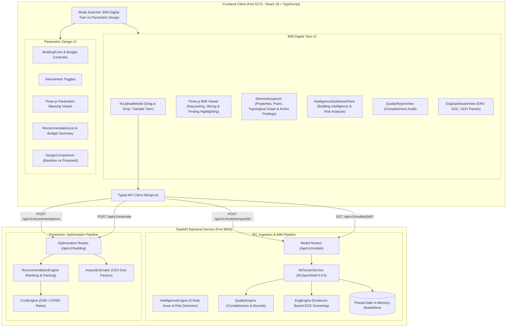

# System Architecture: InfraTwinAI

## 1. System Overview

**InfraTwinAI** is a modular building digital twin, CAD/BIM ingestion, and budget-aware sustainable infrastructure planning platform engineered for architects, civil engineers, building performance consultants, and small builders.

The platform provides a dual-mode workflow:
1. **BIM Digital Twin Mode**: Ingests industry-standard Industry Foundation Classes (IFC4 / IFC2x3) files, normalizes units, extracts spatial hierarchies and property sets, reconstructs triangulated 3D surface meshes using `IfcOpenShell`, audits data quality and model completeness, conducts evidence-based ESG assessments (ICE v3, CEA 2023, NBC 2016, ECBC 2017), and provides an interactive 3D raycast element inspector.
2. **Parametric Design Mode**: Allows users to parameterize building geometry (footprint dimensions, floor counts, floor height, window density) and input an improvement budget in Indian Rupees (INR). The system deterministically computes spatial metrics, renders an interactive, real-time 3D architectural model using Three.js, validates constraints, and invokes a FastAPI backend to rank eligible sustainable design interventions according to affordability, building suitability, and benchmark evidence.

---

## 2. Component Responsibilities

### Frontend Layer (`frontend/src/`)
- **`App.tsx`**: Central state orchestrator coordinating mode transitions (`BIM Digital Twin` vs `Parametric Design`), active subtabs (`3D Digital Twin`, `Quality Audit`, `ESG Screening`), live model loading, building parameters, backend connection polling, and responsive layout.
- **`components/BuildingViewer.tsx`**: Unified Three.js WebGL scene lifecycle manager.
  - *In BIM Mode*: Ingests canonical element meshes, applies type-specific architectural PBR materials, handles raycasting to select elements, manages storey slicing filters, category visibility toggles, computes bounding-sphere camera recentering, and dynamically highlights elements flagged by findings (Rose for High, Amber for Warning) with instant reset actions.
  - *In Parametric Mode*: Synthesizes real-time procedural geometry (plinth, structural floor slabs, plaster walls, distributed facade window apertures with frames, flat roof parapets, and intervention overlays: timber louvers, cool roof coating, XPS insulation deck, tilted photovoltaic arrays).
  - Handles GPU memory disposal (`dispose()`) for geometries and materials on unmount and model switch.
- **`components/IfcUploadModal.tsx`**: Secure modal for uploading `.ifc` files (with 50MB size guard and STEP header check) and one-click loading of pre-parsed reference buildings (`sample-office-twin`).
- **`components/ElementInspector.tsx`**: Flyout inspection drawer rendering clicked element metadata: GlobalId (with copy-to-clipboard action), entity classification, dimensions (length, height, width, volume, area), material names, spatial storey containment, topological BIM graph (`hosted_in`, `hosts`, `connected_to`), complete property sets (`Pset_*`), and associated intelligence/risk findings with severity badges.
- **`components/IntelligenceDashboardView.tsx`**: Phase 4 Building Intelligence dashboard presenting KPI cards, 3-column breakdown (categories, materials with volume and %, storeys), search filter, severity & category filter chips, finding cards with why-flagged reasoning, evidence, recommended actions, and "Locate & Highlight in 3D" interaction.
- **`components/QualityReportView.tsx`**: Visual dashboard for BIM data quality displaying completeness ratios, total findings count, severity breakdowns (Critical, Warning, Info), entity audit tables, and actionable remediation cards.
- **`components/EsgDashboardView.tsx`**: Multi-pillar ESG dashboard covering Environmental (Embodied carbon, Scope 2 operational carbon, WWR, rooftop PV), Social (Universal door accessibility, daylighting, vertical egress), and Governance (BIM lineage, property set coverage, approvals readiness), featuring dynamic utility electricity input recalculation.
- **`components/BuildingForm.tsx`**: Parameter capture for manual building dimensions, preset budget buttons (₹50k, ₹1.5L, ₹2.5L, ₹5.0L), and immediate derived spatial metrics.
- **`components/DesignComparison.tsx`**: Comparative visualizer providing view modes: **Proposed Design** (with interventions), **Baseline Design** (unmodified original building), and **Side-by-Side Dual Viewport**.
- **`components/RecommendationList.tsx`**: Presentation layer for backend-generated recommendation packages, scores (0-100), rank badges, explainability reasoning, and the one-click "Apply Optimal Bundle" action.
- **`components/BudgetSummary.tsx`**: Financial meter displaying total budget, allocated capital outlay, remaining balance or deficit, and color-coded utilization warnings.
- **`components/ApiStatus.tsx`**: Real-time heartbeat indicator for FastAPI backend health with manual retry trigger.
- **`lib/api.ts`**: Strict TypeScript fetch client with timeout handling (`AbortController`), request sequence fencing, and typed error handling.

### Backend Layer (`backend/app/`)
- **`app/main.py`**: ASGI application entrypoint with narrow CORS configuration, custom validation error handlers preventing stack trace leakage, and route registration.
- **`app/api/model_routes.py`**: Digital twin endpoints for model listing, IFC upload, detail retrieval, element pagination, quality reporting, and ESG assessments.
- **`app/api/routes.py`**: Parametric design endpoints for building parameter validation, intervention recommendations, and cost/impact estimation.
- **`app/models/digital_twin.py`**: Authoritative Pydantic v2 schemas: `BoundingBox3D`, `ElementGeometry`, `BuildingElement`, `StoreyInfo`, `BuildingModel`, `BuildingModelDetail`, `QualityFinding`, `ModelQualityReport`, `EsgItem`, and `EsgAssessmentReport`.
- **`app/services/ifc_parser.py`**: Industrial-strength IFC parser leveraging `IfcOpenShell 0.9.0.post1` with unit conversion to metric metres, spatial decomposition, property set extraction, material association, triangulated 3D mesh extraction via `ifcopenshell.geom`, and polygon face decimation.
- **`app/services/intelligence_engine.py`**: Phase 4 Building Intelligence and Risk Analysis engine evaluating 6 core rules: missing statutory properties (FireRating, U-value), missing material definitions, topological disconnects (unhosted doors/windows, isolated framing), duplicate/corrupt GlobalIds, missing storey containment, and geometric collision detection ($\ge 85\%$ volumetric bounding overlap) or dimensional anomalies.
- **`app/services/quality_engine.py`**: Model completeness engine checking spatial hierarchy, missing geometries, duplicate GlobalIds, material assignments, and realistic bounding volumes.
- **`app/services/esg_engine.py`**: Evidence-based ESG evaluation engine computing embodied carbon (ICE v3), Scope 2 operational emissions (CEA 2023 grid factors), window-to-wall ratios (ECBC 2017), solar PV yields (MNRE), NBC 2016 door accessibility, daylighting, and ISO 19650 BIM governance.
- **`app/services/model_store.py`**: Thread-safe in-memory store maintaining loaded digital twin models, pre-seeded with a valid 17-element multi-storey office fixture (`sample_office_building.ifc`).
- **`app/services/cost_engine.py`**: Deterministic cost calculation service implementing standardized Indian construction benchmarks (CPWD DSR 2023, BEE ECBC, MNRE).
- **`app/services/recommendation_engine.py`**: Stateless recommendation logic applying budget eligibility filters, multi-factor transparent scoring, and greedy budget-constrained bundle packing.
- **`app/services/impact_estimator.py`**: Transparent carbon and energy impact calculator using Central Electricity Authority (CEA) grid baseline emission factors (0.716 kg CO2e/kWh).

---

## 3. Technology Selection Rationale

| Technology | Selection Rationale | Alternatives Considered & Rejected |
| :--- | :--- | :--- |
| **IfcOpenShell 0.9.0** | Native open-source C++/Python parser supporting full STEP ISO 10303-21 parsing, IFC2x3 & IFC4 schemas, Open CASCADE geometry tessellation (`ifcopenshell.geom`), and high-performance property set extraction. | Web-ifc (client-side JS parsing exhausts browser memory on large files; limits backend analytical capability), Autodesk Forge/APS (proprietary, paid, requires external cloud API keys). |
| **React 18 + TypeScript** | Strict compile-time type safety ensures synchronization across 3D meshes, API payloads, and form inputs. Broadest UI ecosystem for rapid dashboard development. | Plain JavaScript (lacks type safety), Angular/Vue (higher setup overhead for this prototype). |
| **Vite** | Sub-second Hot Module Replacement (HMR) and optimized Rollup production builds with zero configuration friction. | Create React App (deprecated, sluggish build times), Next.js (unnecessary SSR complexity for client-side WebGL canvas). |
| **Three.js (Direct Canvas)** | Direct imperative WebGL lifecycle control ensures guaranteed memory cleanup (`dispose()`), optimal performance when resizing, and freedom from React Three Fiber / Drei version incompatibilities with modern React. | React Three Fiber (additional abstraction layer; potential version pinning issues), Babylon.js (larger bundle size). |
| **Tailwind CSS** | Utility-first, constraint-based design allows an architectural, restrained aesthetic (slate/stone/charcoal neutrals with subtle emerald accents) without heavyweight UI framework bloat. | Material UI / Ant Design (opinionated styling, heavier runtime bundle overhead). |
| **FastAPI + Uvicorn** | High-performance Python ASGI framework with automatic OpenAPI documentation, native async support, and tight integration with Pydantic v2. | Flask (requires manual validation libraries and lacks native async/OpenAPI), Django (unnecessary ORM, migration, and session weight for a stateless microservice). |
| **Pydantic v2** | Rust-backed validation core with field validators, cross-field model validators, and strict type casting for authoritative server-side validation. | Marshmallow (slower, looser typing), Cerberus (older schema syntax). |

---

## 4. API Endpoints Reference

### BIM Digital Twin Endpoints
- **`GET /api/v1/models`**: List all imported building models with summary metrics.
- **`POST /api/v1/models/import/ifc`**: Ingest an IFC file (multipart/form-data), parses geometry and metadata, stores in model store, and returns an `ImportSummaryResponse`.
- **`GET /api/v1/models/{id}`**: Retrieve full canonical building model details including storeys, summary metrics, and 3D bounding envelope.
- **`GET /api/v1/models/{id}/elements`**: Paginated elements endpoint supporting category and storey filtering, with complete triangulated vertices and faces for Three.js rendering.
- **`GET /api/v1/models/{id}/quality`**: Retrieve data completeness and quality audit report.
- **`GET /api/v1/models/{id}/esg`**: Retrieve evidence-based ESG assessment report with optional `annual_kwh` parameter for operational carbon recalculation.

### Parametric Optimization Endpoints
- **`GET /health`**: Health check probe returning service name and status.
- **`POST /api/v1/building/validate`**: Authoritative server-side parameter validation and spatial feature derivation.
- **`POST /api/v1/recommendations`**: Generates ranked feasible interventions and optimal budget-constrained packages.
- **`POST /api/v1/estimate`**: Detailed cost breakdown and transparent impact estimates.

---

## 5. Current Implementation vs Planned Extensions

```mermaid
graph LR
    subgraph Phase1_2["Current Implementation (Phase 1 & Phase 2)"]
        M1["Local In-Memory Model Store"]
        M2["IfcOpenShell IFC4 / IFC2x3 Parsing"]
        M3["Triangulated Mesh Extraction & Three.js Raycasting"]
        M4["Model Completeness & Data Quality Engine"]
        M5["Evidence-Based ESG Assessment (ICE v3 / CEA / NBC)"]
        M6["Parametric 3D Massing & CPWD Cost Engine"]
    end

    subgraph Future["Future Engineering Extensions"]
        F1["Persistent Model Storage (PostgreSQL + PostGIS)"]
        F2["ezdxf 2D Polyline Extrusion into 3D BIM Elements"]
        F3["Dynamic EnergyPlus Simulation (.idf Export)"]
        F4["Automated Structural Load Analysis (FEM)"]
        F5["BIM Collaboration Format (BCF) Issue Tracking"]
    end

    Phase1_2 -.->|Evolutionary Roadmap| Future
```

