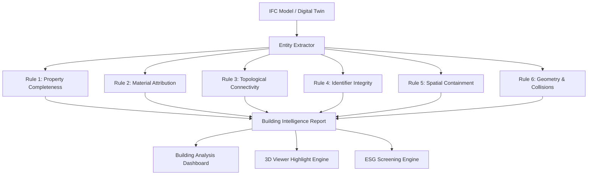

# InfraTwinAI — Building Intelligence and Risk Analysis

This document provides a technical specification and engineering audit of the **Building Intelligence and Risk Analysis Engine** in InfraTwinAI.

---

## 1. Executive Summary & Objective

The Building Intelligence Module analyses imported IFC (Industry Foundation Classes) digital twin models to detect data-quality flaws, topological disconnects, dimensional anomalies, and ESG compliance gaps.

### Engineering Honesty Principle
> [!IMPORTANT]
> **No Structural or Safety Claims Without Validated Finite-Element Modeling:**
> Visual 3D geometry and bounding-box containment do **not** constitute a validated structural engineering, seismic resistance, or fire-safety certification model. InfraTwinAI categorizes findings strictly under **Information**, **Warning**, or **High**, and never labels an element structurally unsafe unless certified by a licensed structural engineer or Eurocode/NBC-compliant FEA engine.

---

## 2. Multi-Category Building Element Extraction

The parser extracts, indexes, and normalizes properties, classifications, and topological relationships for 8 foundational building element categories:

| IFC Element Category | Canonical Representation | Extracted Properties & Spatial Scope |
| :--- | :--- | :--- |
| **Columns** (`IfcColumn`) | Structural vertical compression framing | Bounding box, cross-section profiles, material assignments, storey containment, connected beams. |
| **Beams** (`IfcBeam`) | Structural horizontal flexural framing | Span length, flange/web profiles, connection topology, material specification, elevation. |
| **Walls** (`IfcWall`, `IfcWallStandardCase`) | Vertical spatial enclosures / load-bearing | Thickness (plan min dimension), length, height, hosted apertures (`IfcRelVoidsElement`), U-value, fire rating. |
| **Slabs** (`IfcSlab`) | Horizontal diaphragm decks & floors | Thickness, surface area, bounding volume, elevation, material assignment. |
| **Foundations** (`IfcFooting`) | Substructure footing & load dispersion | Base elevation, width, depth, load-bearing status (`Pset_FootingCommon`). |
| **Doors & Windows** (`IfcDoor`, `IfcWindow`) | Envelope and egress apertures | Width, height, glazing material, host wall (`IfcRelFillsElement`), accessibility clearance. |
| **Roofs** (`IfcRoof`) | Topmost weatherproofing & insulation envelope | Projected area, thermal transmittance (`Pset_RoofCommon`), slope/geometry. |
| **Storeys & Spaces** (`IfcBuildingStorey`, `IfcSpace`) | Spatial hierarchy and interior occupancy | Storey elevation, decomposed spaces (`IfcRelAggregates`), net floor area, natural ventilation tags. |

---

## 3. The 6 Rule Checks & Finding Structure

For every identified concern, the engine creates an immutable `IntelligenceFinding` with:
- **`title`**: Concise finding name.
- **`affected_element_id`** & **`affected_global_id`**: Internal element UUID and ISO 10303-21 STEP GUID.
- **`affected_element_name`** & **`affected_element_type`**: Human-readable name and IFC entity class.
- **`severity`**: `High`, `Warning`, or `Information`.
- **`why_flagged`**: Engineering reasoning explaining the condition.
- **`evidence`**: Source properties, dimensions, or topological indicators extracted from the IFC file.
- **`recommended_action`**: Practical next action for the BIM coordinator or engineering team.



### Rule 1: Property Completeness & Safety Attribution
- **Target**: Structural and envelope elements (`IfcWall`, `IfcColumn`, `IfcBeam`, `IfcSlab`, `IfcRoof`, `IfcDoor`).
- **Check 1A (`Information`)**: Missing `FireRating` property in standard Pset (`Pset_WallCommon`, `Pset_DoorCommon`, etc.). Flagged because statutory life-safety audits require explicit hourly ratings (e.g., 60 min, 120 min).
- **Check 1B (`Information`)**: Missing `ThermalTransmittance` (U-value) on exterior walls/roofs (`IsExternal = True`). Flagged because energy code compliance (ASHRAE 90.1, ECBC India) requires thermal transmittance inputs.

### Rule 2: Material Attribution Integrity
- **Target**: Physical building elements.
- **Check (`Warning`)**: Element without any `IfcMaterial`, `IfcMaterialList`, or `IfcMaterialLayerSetUsage`.
- **Reasoning**: Embodied carbon calculations (A1-A3 cradle-to-gate) cannot be computed without verified material density and carbon emission factors.

### Rule 3: Topological Connectivity & Aperture Hosting
- **Target**: `IfcDoor`, `IfcWindow`, and framing elements.
- **Check 3A (`Warning`)**: Aperture with no host wall (`door_window_to_wall` mapping empty). Evaluated via topological traversal: `IfcRelFillsElement` $\rightarrow$ `IfcOpeningElement` $\rightarrow$ `IfcRelVoidsElement` $\rightarrow$ `IfcWall`.
- **Reasoning**: Unhosted doors/windows represent detached BIM entities that will distort thermal envelope calculations and quantity takeoffs.
- **Check 3B (`Information`)**: Isolated structural framing without structural connection records (`IfcRelConnectsElements`).

### Rule 4: Identifier Conflict & GUID Integrity
- **Target**: All building elements.
- **Check 4A (`High`)**: Duplicate `GlobalId` shared by two or more distinct entities.
- **Reasoning**: Violates ISO 10303-21 standard and IFC specifications; causes identity collisions in twin synchronization.
- **Check 4B (`Warning`)**: Missing or corrupt GlobalId.

### Rule 5: Spatial Containment & Storey Hierarchy
- **Target**: All elements.
- **Check (`Warning`)**: Element not contained in any `IfcBuildingStorey` via `IfcRelContainedInSpatialStructure` or `IfcRelAggregates`.
- **Reasoning**: Prevents storey-by-storey filtering, structural floor load attribution, and phased construction scheduling.

### Rule 6: Geometric Overlaps & Dimension Anomalies
- **Target**: Physical 3D bounding boxes.
- **Check 6A (`High`)**: Double-modeled component collision: identical entity categories with $\ge 85\%$ volumetric bounding box intersection:
  $$\text{Overlap Ratio} = \frac{\text{Intersection Volume}}{\min(\text{Vol}_A, \text{Vol}_B)} \ge 0.85$$
  Flags duplicate drafting artifacts that artificially double material costs and carbon take-offs.
- **Check 6B (`Warning`)**: Substandard wall thickness in plan $< 50\text{ mm}$ (likely a 2D drawing line extrusion or finish layer misclassified as a wall).
- **Check 6C (`Information`)**: Massive wall thickness in plan $> 1.50\text{ m}$ (retaining mass or boundary block).
- **Check 6D (`Warning`)**: Narrow door width $< 700\text{ mm}$ (violates standard wheelchair accessibility and egress norms).
- **Check 6E (`Warning`)**: Low headroom clearance $< 1.80\text{ m}$.
- **Check 6F (`Warning`)**: Zero or degenerate volume for physical structural elements.

---

## 4. Building Analysis Dashboard Aggregation

The dashboard presents model-wide aggregations derived strictly from the active IFC file:

1. **Total Building Elements**: Real count of parsed entities.
2. **Category Distribution**: Breakdown by element type (`IfcWall`, `IfcColumn`, etc.) with count and percentage share.
3. **Material Distribution**: Quantitative volume ($\text{m}^3$) and volumetric share for each assigned material, highlighting unspecified materials.
4. **Model Completeness Percentage**:
   $$\text{Completeness} = \frac{\text{Elements with valid geometry, unique GUID, and material assignment}}{\text{Total Elements}} \times 100\%$$
5. **Findings by Severity**: Instant count of `High`, `Warning`, and `Information` concerns.
6. **Storey-Wise Distribution**: Elevation and element distribution per architectural floor.

---

## 5. 3D Issue Visualization & Interaction

The Three.js viewer and intelligence findings operate as a unified, bi-directional system:

```
[Intelligence Dashboard Finding] --- Click 'Locate & Highlight in 3D' ---> [Three.js 3D Viewport]
  - Switches active tab to 3D Digital Twin
  - Glows affected element in high-contrast Rose (High) or Amber (Warning)
  - Opens ElementInspector displaying the finding's why_flagged & evidence
  - Provides instant "Clear Highlight" button to reset viewport
```

When clicking any element directly in 3D:
1. `ElementInspector` highlights the component.
2. Checks all model findings for matching `affected_element_id` or `source_global_id`.
3. Displays **Associated Risk & Quality Findings** with severity badges, source evidence, and recommended actions.
4. Shows topological relationships:
   - `hosted_in`: Parent wall UUID.
   - `hosts`: All hosted aperture IDs.
   - `connected_to`: Adjacent structural nodes.
5. Displays classification tags (`PredefinedType`, `ObjectType`).

---

## 6. ESG Foundation Enhancements

- **Environmental (Embodied Carbon)**: Computes cradle-to-gate carbon ($\text{kgCO}_2\text{e}$) only where valid material assignments and bounding volumes exist; leaves unassigned elements clearly flagged as missing data.
- **Social (Natural Ventilation `SOC-04`)**:
  - Evaluates window aperture-to-floor area ratio against National Building Code of India (NBC 2016 Part 8) minimum $1/8$ ($12.5\%$) standard.
  - Checks presence of `NaturallyVentilated` boolean flag in `Pset_SpaceCommon`.
  - Flags inadequate aperture areas as `potential_concern` with actionable recommendations.
- **Governance**: Tracks model provenance, STEP GUIDs, and ISO 10303-21 metadata, distinguishing missing attributes from true construction defects.
