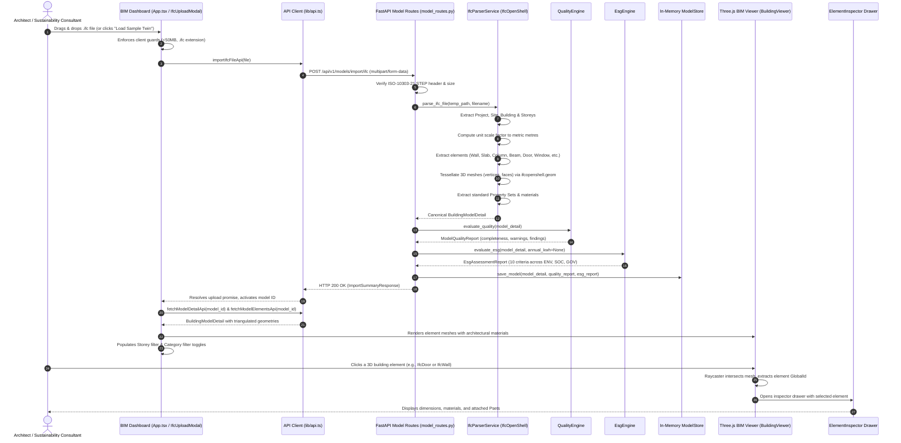
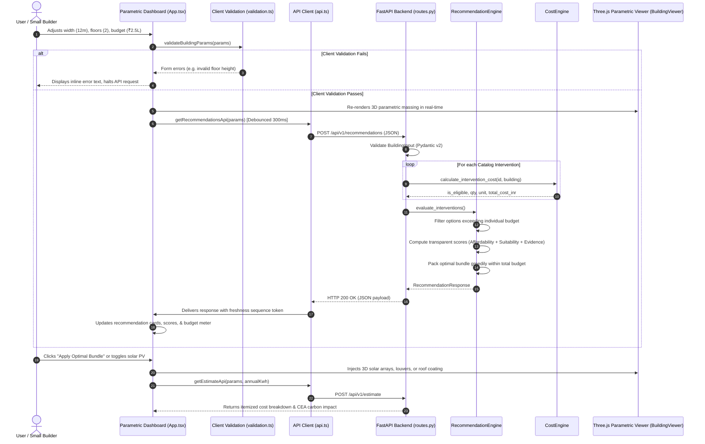

# Data Flow: InfraTwinAI

## 1. System Data Flows Overview

InfraTwinAI supports two unified architectural data flows:
1. **BIM Digital Twin Ingestion, Quality Audit & ESG Screening Flow**: Ingestion of open-standard IFC files, Open CASCADE mesh tessellation, spatial hierarchy mapping, data completeness auditing, and evidence-based ESG assessment.
2. **Parametric Design & Budget Optimization Flow**: Instant procedural 3D massing, deterministic cost calculation, transparent multi-factor recommendation ranking, and greedy budget packing.

---

## 2. Sequence A: BIM Digital Twin Ingestion & Inspection Flow



---

## 3. Sequence B: Parametric Design & Budget Recommendation Flow



---

## 4. Step-by-Step Flow Stages (Parametric Optimization)

### Stage 1: User Parameter Input & Client-Side Verification
1. User adjusts sliders, numeric inputs, or selects preset buttons (`₹50k`, `₹1.5L`, `₹2.5L`, `₹5.0L`) in `BuildingForm.tsx`.
2. `validation.ts` evaluates boundary rules:
   - Width and Length: $(0, 200]\,\text{m}$
   - Floor Height: $[1.5, 10.0]\,\text{m}$
   - Floor Count: $[1, 50]$
   - Window Count: $[0, 1000]$
   - Window-to-Wall Ratio check: Ensures estimated window aperture surface $(\text{window\_count} \times 2.0\,\text{m}^2)$ does not exceed $90\%$ of total gross wall area.
   - Budget: $[0, 1{,}000{,}000{,}000]\,\text{INR}$
3. If invalid, the UI marks specific input fields with red borders and explanatory messages, preventing outbound API calls.
4. If valid, the Three.js viewport immediately recalculates mesh coordinates without awaiting network roundtrips.

---

### Stage 2: Outbound API Request & Race-Condition Guarding
1. `App.tsx` initiates a 300ms debounce timer to prevent firing HTTP requests on every keystroke.
2. `lib/api.ts` increments an internal sequence token (`latestRecommendationSeq`).
3. An `AbortController` is attached with an 8-second timeout threshold.
4. The request payload is transmitted via HTTP `POST` with `Content-Type: application/json` to `http://localhost:8000/api/v1/recommendations`.

---

### Stage 3: Authoritative Backend Validation
1. FastAPI deserializes the JSON body into the `RecommendationRequest` Pydantic model.
2. Field-level validation asserts numeric bounds and integer constraints.
3. Cross-field spatial checks (`validate_spatial_consistency`) verify architectural plausibility.
4. If the request is malformed, FastAPI triggers `validation_exception_handler`, converting raw schema failures into clean, sanitized JSON arrays (`HTTP 422 Unprocessable Content`) with zero stack traces leaked.

---

### Stage 4: Deterministic Cost Calculation & Filtering
`CostEngine` determines quantities and capital expenditure for each catalog intervention:

| Intervention | Sizing Logic | Unit Benchmark Rate | Total Cost Formula |
| :--- | :--- | :--- | :--- |
| **External Shading Louvers** (`external_shading`) | $Q = \text{window\_count}$ | ₹4,500 / window | $\text{Cost} = Q \times 4{,}500$ |
| **High-Albedo Cool Roof** (`reflective_roof`) | $Q = \text{width} \times \text{length}$ | ₹250 / $\text{m}^2$ | $\text{Cost} = Q \times 250$ |
| **Over-Deck Roof Insulation** (`roof_insulation`) | $Q = \text{width} \times \text{length}$ | ₹850 / $\text{m}^2$ | $\text{Cost} = Q \times 850$ |
| **Rooftop Solar PV Array** (`solar_pv`) | $Q = \lfloor\frac{\text{Roof Area} \times 0.60}{10.0} \times 2\rfloor / 2$ | ₹48,000 / kWp | $\text{Cost} = Q \times 48{,}000$ |

Eligibility rules are strictly checked:
- If `window_count == 0`, external shading is marked ineligible (`"No windows detected"`).
- If usable roof area $< 16.7\,\text{m}^2$ ($< 1.0\,\text{kWp}$), solar PV is marked ineligible (`"Below 1.0 kWp threshold"`).

---

### Stage 5: Multi-Factor Transparent Recommendation Scoring
For all eligible interventions where $\text{Cost} \le \text{Budget}$, a transparent composite score $S \in [0, 100]$ is computed:

$$S = S_{\text{affordability}} + S_{\text{suitability}} + S_{\text{evidence}}$$

1. **Affordability Factor** ($0 - 40$ pts):
   $$S_{\text{affordability}} = \left(1 - \frac{\text{Cost}}{\text{Budget}}\right) \times 40$$
2. **Suitability Factor** ($0 - 40$ pts):
   - External Shading: 38 pts if $\text{WWR} > 20\%$ or windows $\ge 8$; 26 pts otherwise.
   - Reflective Cool Roof: 38 pts for low-rise buildings ($\le 2$ floors) with high roof-to-envelope exposure; 26 pts for taller buildings.
   - Roof Insulation: 35 pts for $\le 2$ floors; 24 pts for taller buildings.
   - Solar PV: 37 pts if array capacity $\ge 3.0\,\text{kWp}$; 30 pts otherwise.
3. **Evidence Quality Benchmark** ($0 - 20$ pts):
   - Fixed at 18 pts for published government benchmarks (CPWD / BEE ECBC / MNRE).

---

### Stage 6: Greedy Budget-Constrained Bundle Packing
1. Candidates are sorted in descending order of score $S$.
2. The engine iterates through the candidates, adding items to the optimal recommended package as long as $\sum \text{Cost} \le \text{Budget}$.
3. If an individually affordable intervention would cause the combined package cost to exceed the budget, it is retained in the available list but explicitly excluded from the package with a transparent explanation.
4. Remaining budget balance is calculated: $\text{Remaining} = \text{Budget} - \sum \text{Cost}_{\text{recommended}}$.

---

### Stage 7: Impact Estimation & Scientific Honesty
The impact engine (`POST /api/v1/estimate`) processes selected interventions:
- **Baseline Carbon Emissions**:
  - If `annual_electricity_kwh` is provided by user:
    $$\text{Emissions} = \frac{\text{kWh} \times 0.716\,\text{kg CO}_2\text{e/kWh}}{1000} \quad (\text{tCO}_2\text{e/year})$$
  - If omitted: Marked `is_estimated = false` with note: *"Requires actual utility billing history"*.
- **Solar Generation & Avoided Carbon**:
  - Computed from MNRE specific yield:
    $$\text{Yield} = \text{Capacity (kWp)} \times 1{,}450\,\text{kWh/kWp/yr}$$
    $$\text{Avoided Emissions} = \frac{\text{Yield} \times 0.716}{1000} \quad (\text{tCO}_2\text{e/year})$$
- **Passive Envelope Measures**:
  - Explicitly marked `is_estimated = false` with statement: *"Requires 8,760-hour dynamic thermal simulation (EnergyPlus / EPW weather file) to avoid scientifically fraudulent claims"*.

---

### Stage 8: UI Updates & Three.js Mesh Synchronization
1. `lib/api.ts` verifies that the incoming response matches the latest sequence token, discarding any outdated asynchronous responses.
2. The React dashboard updates the recommendation list and budget bar.
3. Clicking **"Apply Optimal Bundle"** updates `params.selected_interventions`.
4. `BuildingViewer.tsx` receives the updated intervention array, clears previous geometry buffers, and instantiates 3D louvers, reflective roof finishes, insulation decks, or tilted PV arrays.

---

## 5. Error Paths and Resilience

```mermaid
flowchart TD
    Req[User Interaction / IFC Upload] --> Check{Valid Input?}
    Check -->|No| LocalErr[Show Inline UI Error & Halt Outbound Request]
    Check -->|Yes| Fetch[Dispatch fetchWithTimeout]
    
    Fetch --> NetCheck{Network Available?}
    NetCheck -->|No / Timeout| TimeoutErr[Trigger ApiStatus: Backend Offline. Retain local 3D rendering.]
    NetCheck -->|Yes| HTTPCheck{HTTP 200 OK?}
    
    HTTPCheck -->|No (400/413/422/500)| SrvErr[Display Sanitized Error Banner. Do NOT substitute fake mock data.]
    HTTPCheck -->|Yes| SeqCheck{Fresh Response / Valid ID?}
    
    SeqCheck -->|Stale Response| Discard[Silently Discard Out-of-Order Packet]
    SeqCheck -->|Fresh Response| Apply[Update State, Synchronize 3D Scene, Refresh Audit / Budget Panels]
```