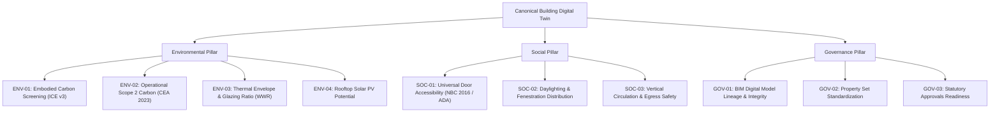

# ESG Assessment Framework: InfraTwinAI

## 1. Executive Summary & Design Philosophy

InfraTwinAI implements an **evidence-based, criterion-level ESG (Environmental, Social, and Governance) assessment framework** purpose-built for architecture, engineering, and construction (AEC) digital twins.

### Rejection of Arbitrary Composite Scores
Traditional commercial ESG scoring systems frequently calculate an opaque single composite number (e.g., "78% ESG Rating"). In sustainable infrastructure, aggregate scores can create misleading or dangerous incentives:
- A building with flawless BIM metadata governance (Governance) could mathematically mask non-compliant, wheelchair-inaccessible doors (Social) or an energy-inefficient, uninsulated envelope (Environmental).
- Unsubstantiated weightings create an illusion of precision without engineering or statutory backing.

**The InfraTwinAI Principle**:
1. **No opaque composite scores**: Assessments evaluate discrete, verifiable criteria independently.
2. **Four transparent evaluation states**:
   - `passed`: Quantitative or qualitative threshold verified from model geometry or properties.
   - `warning`: Threshold suboptimal or potential compliance risk detected.
   - `needs_review`: Data detected but requires physical verification or engineering sign-off.
   - `missing_input`: Necessary data (e.g., annual energy consumption) not present in the model and requires operational user inputs.
3. **Traceable formulas and standards**: Every calculation cites established statutory or academic benchmarks (ICE v3, CEA 2023, NBC 2016, ECBC 2017, ASHRAE 90.1, RIBA 2030).

---

## 2. Framework Overview

---

## 3. Pillar 1: Environmental Criteria (ENV)

### ENV-01: Embodied Carbon Screening
- **Standard**: Circular Ecology *Inventory of Carbon & Energy* (ICE v3.0, University of Bath).
- **Scope**: Cradle-to-gate (A1–A3) embodied carbon for major structural elements (reinforced concrete slabs/columns, brick/block masonry walls).
- **Benchmark / Target**:
  - RIBA 2030 Climate Challenge target for commercial/residential: $< 500\text{ kg CO}_2\text{e/m}^2$.
  - Conventional baseline: $800 - 1,200\text{ kg CO}_2\text{e/m}^2$.
- **Calculation Formula**:
  $$\text{Embodied Carbon} = \sum (\text{Volume}_i \times \text{Density}_i \times \text{ECF}_i)$$
  $$\text{Carbon Intensity} = \frac{\text{Embodied Carbon}}{\text{Gross Floor Area}}$$
  *Default Emission Factors*:
  - Concrete elements: $2,400\text{ kg/m}^3 \times 0.13\text{ kg CO}_2\text{e/kg} = 312\text{ kg CO}_2\text{e/m}^3$
  - Masonry/plaster walls: $1,800\text{ kg/m}^3 \times 0.22\text{ kg CO}_2\text{e/kg} = 396\text{ kg CO}_2\text{e/m}^3$
- **Evaluation Rule**:
  - `passed` if intensity $\le 800\text{ kg CO}_2\text{e/m}^2$.
  - `warning` if $> 800\text{ kg CO}_2\text{e/m}^2$.

### ENV-02: Operational Scope 2 Carbon Intensity
- **Standard**: Central Electricity Authority (CEA) of India CO2 Baseline Database (Ver 19.0, 2023) / IEA National Grids.
- **Scope**: Scope 2 indirect emissions from building electricity consumption.
- **Emission Factor**: Grid carbon factor of $0.716\text{ kg CO}_2\text{e/kWh}$.
- **Calculation Formula**:
  $$\text{Annual Scope 2 Carbon} = \text{Annual Consumption (kWh)} \times 0.716\text{ kg CO}_2\text{e/kWh}$$
- **Evaluation Rule**:
  - If annual kWh is supplied by user: `passed` (if $\le 80\text{ kg CO}_2\text{e/m}^2/\text{yr}$) or `warning`.
  - If annual kWh is not supplied: `missing_input` with clear prompt to provide meter or simulated data.

### ENV-03: Thermal Envelope & Glazing Ratio (WWR)
- **Standard**: Energy Conservation Building Code (ECBC 2017) & ASHRAE Standard 90.1.
- **Scope**: Window-to-Wall Ratio (WWR) of the exterior envelope.
- **Recommended Range**: $20\% \le \text{WWR} \le 40\%$ for balanced daylighting and solar heat gain control in tropical and sub-tropical climates.
- **Calculation Formula**:
  $$\text{WWR} = \frac{\sum \text{Window Glazing Area}}{\sum \text{Exterior Wall Gross Area}} \times 100\%$$
- **Evaluation Rule**:
  - `passed` if $15\% \le \text{WWR} \le 40\%$.
  - `warning` if $> 40\%$ (excessive solar heat gain and AC cooling loads) or $< 15\%$ (insufficient natural illumination).

### ENV-04: Rooftop Solar PV Potential
- **Standard**: MNRE (Ministry of New and Renewable Energy) / NREL PVWatts solar estimation guidelines.
- **Scope**: Technical rooftop PV generation potential on horizontal terrace slabs.
- **Assumptions**:
  - Usable roof area: $70\%$ (allowing $30\%$ for HVAC outdoor units, parapet shading, and maintenance access).
  - Power density: $150\text{ Wp/m}^2$ using commercial crystalline silicon panels.
  - Specific yield: $1,450\text{ kWh/kWp/year}$ (representative tropical solar insolation).
- **Calculation Formula**:
  $$\text{System Capacity (kWp)} = \text{Roof Area (m}^2) \times 0.70 \times 0.150\text{ kWp/m}^2$$
  $$\text{Annual Clean Energy (MWh)} = \frac{\text{Capacity (kWp)} \times 1,450\text{ kWh/kWp}}{1,000}$$
- **Evaluation Rule**:
  - `passed` if capacity $> 0\text{ kWp}$.
  - `needs_review` if no designated roof or terrace slab is detected in model hierarchy.

---

## 4. Pillar 2: Social Criteria (SOC)

### SOC-01: Universal Door Accessibility
- **Standard**: India National Building Code (NBC 2016, Vol. 1, Part 3, Clause 12) & Americans with Disabilities Act (ADA Standards 404.2.3).
- **Scope**: Minimum clear opening width for accessible barrier-free circulation.
- **Benchmark**: Clear door opening $\ge 900\text{ mm}$ ($0.90\text{ m}$) for main entrance and public circulation doors; minimum $800\text{ mm}$ for secondary rooms.
- **Evaluation Rule**:
  - `passed` if $100\%$ of detected doors have width $\ge 900\text{ mm}$.
  - `warning` if any door has clear width $< 900\text{ mm}$, citing specific door GlobalIds.

### SOC-02: Daylighting & Fenestration Distribution
- **Standard**: NBC 2016 Part 8 (Building Services, Section 1: Lighting & Ventilation) & LEED v4.1 Daylight Quality.
- **Scope**: Minimum aggregate window area relative to gross occupied floor area.
- **Benchmark**: Aggregate window aperture area must equal or exceed $10\%$ to $15\%$ of floor area.
- **Evaluation Rule**:
  - `passed` if Window Area / Floor Area $\ge 12\%$.
  - `warning` if $< 10\%$.

### SOC-03: Vertical Circulation & Egress Safety
- **Standard**: NBC 2016 Part 4 (Fire and Life Safety) & NFPA 101 Life Safety Code.
- **Scope**: Presence and integrity of vertical egress routes across multi-storey facilities.
- **Evaluation Rule**:
  - For buildings with $> 1$ storey:
    - `passed` if at least one compliant stair flight (`IfcStair`) is explicitly modeled.
    - `warning` if multiple storeys are detected with zero stair elements (indicates missing life safety egress data).
  - Single-storey buildings automatically pass.

---

## 5. Pillar 3: Governance Criteria (GOV)

### GOV-01: BIM Digital Model Lineage & Integrity
- **Standard**: ISO 19650 (Organization and digitization of information about buildings and civil engineering works, including BIM).
- **Scope**: Verification of open-standard compliance (ISO 10303-21 STEP physical file), schema validity (IFC4 or IFC2x3), and unique element identifier integrity.
- **Evaluation Rule**:
  - `passed` if schema is valid, zero duplicate GlobalIds exist, and $< 5\%$ of elements lack geometric representations.
  - `warning` if orphaned elements or missing entity definitions are present.

### GOV-02: Property Set Standardization & Procurement Lineage
- **Standard**: buildingSMART IFC Standard Property Sets (`Pset_*`).
- **Scope**: Consistent attachment of standardized property sets (e.g., `Pset_WallCommon`, `Pset_DoorCommon`, `Pset_SlabCommon`) to support transparent cost estimation and embodied carbon audits.
- **Evaluation Rule**:
  - `passed` if $\ge 70\%$ of loadbearing and envelope elements possess standard property sets.
  - `warning` if properties are missing, noting the risk of procurement ambiguity.

### GOV-03: Statutory Approvals Readiness
- **Standard**: Municipal Development Control Regulations (DCR) and Building Bye-Laws.
- **Scope**: Structural and spatial completeness required for municipal plan submission (building height, gross floor area, storey containment, plinth footprint).
- **Evaluation Rule**:
  - `passed` if building footprint, storey heights, and major categories are fully resolved.
  - `needs_review` if spatial containment is partially defined.

---

## 6. Real-Time Operational Feedback & ESG Recalculation

The frontend provides an interactive input panel within the ESG tab where users can enter real-time utility electricity consumption ($\text{kWh/year}$). Upon submission, the platform:
1. Re-evaluates `ENV-02` (Scope 2 Carbon Intensity).
2. Updates total operational carbon ($\text{tCO}_2\text{e/year}$) and carbon per unit area ($\text{kg CO}_2\text{e/m}^2/\text{year}$).
3. Adjusts the status badge from `missing_input` to `passed` or `warning` dynamically without requiring model re-ingestion.