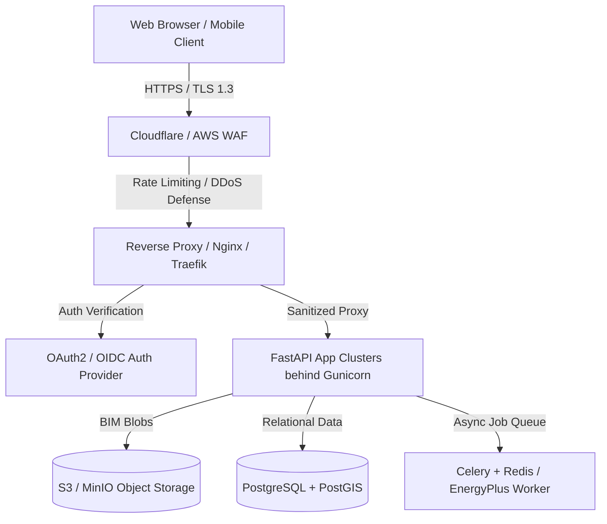

# Security, Data Governance, and Limitations

## 1. Implemented Security Controls

The platform implements multi-layer defensive engineering practices suited for a local, standalone decision-support application:

| Security Vector | Implementation Mechanism | Purpose |
| :--- | :--- | :--- |
| **BIM File Upload Size Cap** | Strict 50 MB byte limit enforcement at the route boundary (`HTTP 413 Entity Too Large`). | Prevents memory exhaustion and resource denial-of-service from massive BIM files. |
| **File Extension & Format Allowlist** | Only `.ifc`, `.ifcxml`, and `.ifczip` are accepted (`HTTP 400 Bad Request`). | Blocks executable uploads, malicious shell scripts, or unsupported binary types. |
| **STEP ISO-10303-21 Header Validation** | First 1,024 bytes are inspected for `ISO-10303-21;` before triggering the parser. | Rejects renamed binaries or spoofed text files before parsing. |
| **Path Traversal Protection** | Client filenames are stripped using `os.path.basename` and replaced with safe server-side temporary file descriptors via `tempfile.NamedTemporaryFile`. | Defends against directory traversal (`../../etc/passwd`) attacks. |
| **Zero Host Path Leakage** | Tempfiles are unlinked immediately in `finally:` blocks; internal server paths are never returned in JSON payloads. | Protects host file structure from client reconnaissance. |
| **Server-Side Input Sanitization** | Pydantic v2 strict schemas with custom field & model validators (`BuildingInput`, `BuildingModelDetail`). | Enforces mathematical bounds on floating-point dimensions and integers; prevents integer overflows or memory exhaustion attacks from extreme values. |
| **Sanitized Error Responses** | Custom FastAPI exception handlers (`RequestValidationError` & generic 500 handler). | Strips stack traces, environment variables, internal file paths, and framework versions from client error responses. |
| **Narrow CORS Configuration** | `CORSMiddleware` restricted to `http://localhost:5173` and `http://127.0.0.1:5173`. | Prevents unauthorized cross-origin requests from arbitrary browser contexts while facilitating local development. |
| **Zero Dynamic Code Execution** | Pure deterministic Python calculation routines (`CostEngine`, `RecommendationEngine`, `IfcParserService`, `QualityEngine`, `EsgEngine`). | Completely avoids `eval()`, `exec()`, runtime template compilation, or dynamic SQL queries. User input cannot manipulate execution flow. |
| **Geometry Tessellation Decimation** | Elements exceeding 4,500 faces are safely downsampled during geometry conversion. | Protects client WebGL contexts from memory exhaustion and browser tab freezing. |
| **WebGL Resource Disposal** | Explicit Three.js `geometry.dispose()` and `material.dispose()` calls on component unmount and mesh regeneration. | Prevents GPU WebGL memory leaks during rapid model switching. |

---

## 2. Current Architecture Scope & Limitations

InfraTwinAI is engineered as a technical prototype for jury review and decision support:

1. **In-Memory Digital Twin Storage**:
   - The platform utilizes a thread-safe in-memory model repository (`model_store.py`). Uploaded models persist for the duration of the server process. Production deployment will require an object storage system (S3/MinIO) and spatial database (PostgreSQL with PostGIS).
2. **Visual Mesh Representation vs Structural Engineering Model**:
   - Extracted 3D meshes are optimized for architectural inspection and spatial property verification. The system explicitly does **not** claim to provide an authoritative finite element structural load analysis (FEM) or seismic engineering validation.
3. **Absence of User Authentication**:
   - The application does not include login, multi-tenant isolation, or Role-Based Access Control (RBAC). Any user with local network access to the port can query the endpoints.
4. **DXF 2D Extrusion & PDF Extraction Roadmap**:
   - Native IFC ingestion is fully implemented. 2D DXF polyline extrusion and raster plan extraction remain planned roadmap extensions.
5. **No Built-in TLS / HTTPS**:
   - Local development operates over unencrypted HTTP (`127.0.0.1:8000`).

---

## 3. Data and Privacy Considerations

- **Zero Telemetry or External Tracking**: The application makes zero calls to Google Analytics, CDN tracking pixels, or third-party behavioral trackers.
- **Zero Cloud Leakage**: No building geometries, CAD models, financial budgets, or design choices leave the local host machine.
- **No Personal Identifiable Information (PII)**: The system processes only physical quantities and standard BIM metadata, never soliciting personal or financial credentials.

---

## 4. Production Hardening Requirements

Prior to deploying this system to an internet-facing production environment (e.g. AWS, GCP, or a private enterprise server), the following controls must be implemented:

1. **Authentication & Authorization**:
   - Implement OAuth2 with PKCE or JWT tokens for user identity.
   - Enforce project-level Access Control Lists (ACLs) so teams only access their own client designs.
2. **Transport Layer Security (TLS)**:
   - Enforce HTTPS with TLS 1.3 and HSTS headers.
   - Redirect all insecure HTTP port 80 traffic to port 443.
3. **Rate Limiting & File Upload Quotas**:
   - Implement Redis-backed sliding-window rate limiting.
   - Quarantine and scan uploaded CAD/IFC files in isolated sandboxed workers.
4. **Secret Management**:
   - Store sensitive deployment configuration in AWS Secrets Manager, HashiCorp Vault, or GCP Secret Manager.
   - Never commit production `.env` files into source control.
5. **Observability & Audit Logging**:
   - Structured JSON logging (`structlog`) with distributed trace IDs.
   - Centralized monitoring via Prometheus / Grafana or Datadog to track p95 latency and upload throughput.

---

## 5. Scientific Assumptions & Estimation Limitations

To maintain uncompromising scientific honesty, the system adheres to strict engineering boundaries:

### A. Embodied Carbon Screening (ICE v3)
- Calculated using University of Bath Inventory of Carbon & Energy (ICE v3.0) cradle-to-gate (A1–A3) emission factors.
- **Limitation**: Transport to site (A4) and construction assembly (A5) emissions vary by local supply chain and are not fabricated without specific logistics data.

### B. Grid Carbon Emission Calculation (CEA 2023)
- Grid operational emissions use the **Central Electricity Authority (CEA) CO2 Baseline Database for the Indian Power Sector (Version 19, December 2023)**, establishing an average grid emission factor of:
  $$\text{Grid Emission Factor} = 0.716\,\text{kg CO}_2\text{e / kWh}$$
- **Limitation**: Represents national weighted average grid emissions; does not account for hourly marginal grid variations or regional renewable purchase obligations.

### C. Solar PV Specific Yield (MNRE / NREL)
- Solar potential assumes standard Indian conditions of **$1{,}450\,\text{kWh / kWp / year}$** with a $75\%$ system performance ratio and optimal southward tilt ($15^\circ - 20^\circ$).
- **Limitation**: Does not account for real-world horizon shading, dust/soiling degradation in arid regions, or local distribution transformer hosting capacity constraints.

### D. Why Passive Envelope Energy Savings Are NOT Fabricated
- In the absence of an authenticated 8,760-hour EnergyPlus simulation model using microclimate EPW weather files, reporting an arbitrary carbon or energy reduction would be scientifically fraudulent. Our tool explicitly marks passive cooling savings as **"Not Estimated"** and lists the exact missing engineering inputs required.