# InfraTwin AI: Data Flow & Subsystem Architecture Diagrams
**Version:** 2.4.0 (Hackathon Technical Jury Edition)  
**Author:** InfraTwin AI Engineering Team  
**Date:** October 31, 2026

---

## Table of Diagrams

1. [Diagram 1: End-to-End Overall System Architecture](#diagram-1-end-to-end-overall-system-architecture)
2. [Diagram 2: Frontend React Component Hierarchy & State Propagation](#diagram-2-frontend-react-component-hierarchy--state-propagation)
3. [Diagram 3: Backend FastAPI Architecture & Router Mapping](#diagram-3-backend-fastapi-architecture--router-mapping)
4. [Diagram 4: Geolocation & Microclimate Environmental Data Flow](#diagram-4-geolocation--microclimate-environmental-data-flow)
5. [Diagram 5: BIM Ingestion to 3D WebGL Digital Twin Pipeline](#diagram-5-bim-ingestion-to-3d-webgl-digital-twin-pipeline)
6. [Diagram 6: 2D Raster Plan to 3D Geometry Extrusion Pipeline](#diagram-6-2d-raster-plan-to-3d-geometry-extrusion-pipeline)
7. [Diagram 7: IFC Parsing & Schema Adaptation Pipeline](#diagram-7-ifc-parsing--schema-adaptation-pipeline)
8. [Diagram 8: AI/ML Model Training & Inference Pipeline](#diagram-8-aiml-model-training--inference-pipeline)
9. [Diagram 9: Recommendation & Optimization Bundle Engine](#diagram-9-recommendation--optimization-bundle-engine)
10. [Diagram 10: Multi-Domain Hydrological, Flood & Subsurface Pipeline](#diagram-10-multi-domain-hydrological-flood--subsurface-pipeline)
11. [Diagram 11: 10 Geospatial Datasets Ingestion & Spatial Profile Cache](#diagram-11-10-geospatial-datasets-ingestion--spatial-profile-cache)
12. [Diagram 12: Feature-to-File End-to-End Traceability Flow](#diagram-12-feature-to-file-end-to-end-traceability-flow)

---

### Diagram 1: End-to-End Overall System Architecture

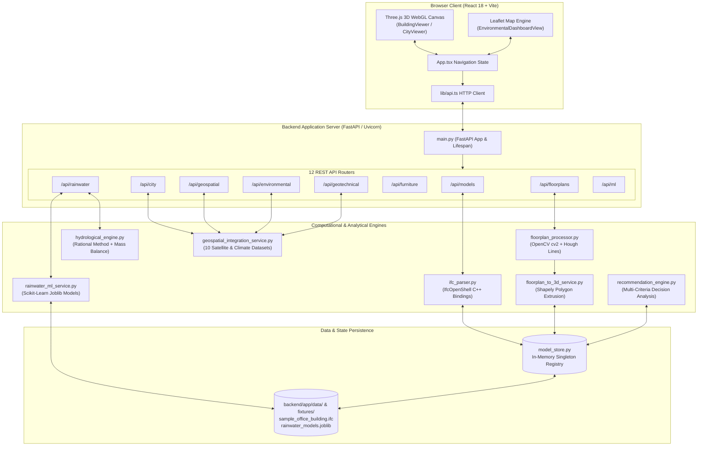

---

### Diagram 2: Frontend React Component Hierarchy & State Propagation

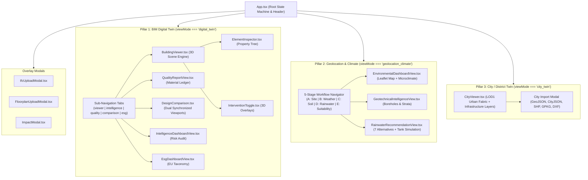

---

### Diagram 3: Backend FastAPI Architecture & Router Mapping

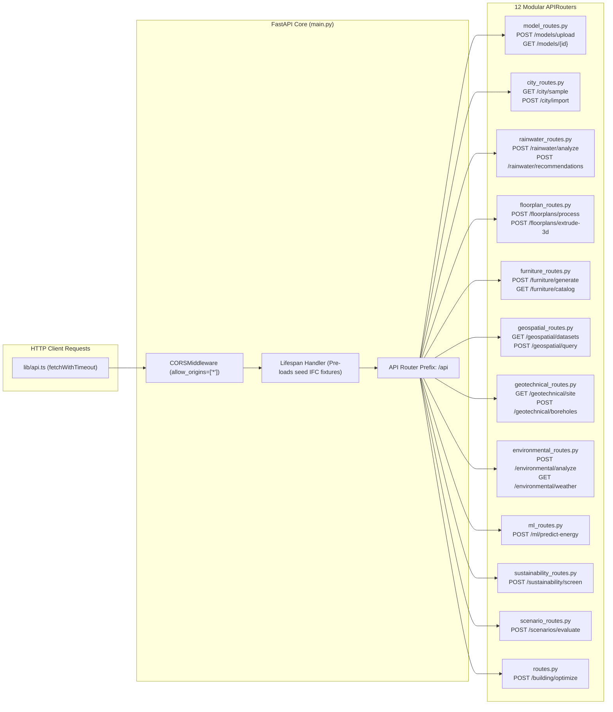

---

### Diagram 4: Geolocation & Microclimate Environmental Data Flow

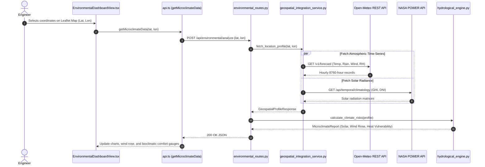

---

### Diagram 5: BIM Ingestion to 3D WebGL Digital Twin Pipeline

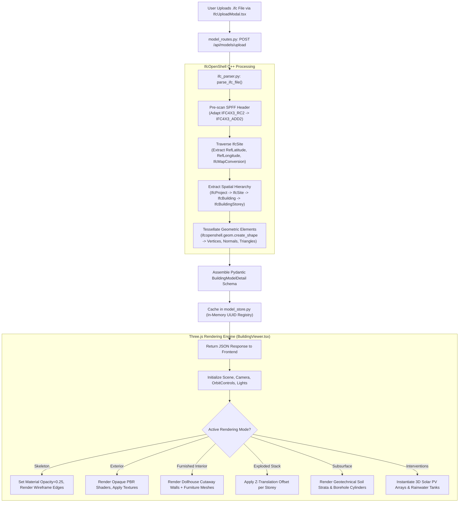

---

### Diagram 6: 2D Raster Plan to 3D Geometry Extrusion Pipeline

```mermaid
flowchart LR
    subgraph Step1["Step 1: Ingestion & Preprocessing"]
        A["Raster Image\n(PNG / JPG / PDF)"] --> B["CLAHE Contrast\nEnhancement"]
        B --> C["Adaptive Gaussian\nThresholding"]
        C --> D["Morphological Opening\n(Remove Text & Dimension Lines)"]
    end

    subgraph Step2["Step 2: Vectorization & Spatial Topology"]
        D --> E["Probabilistic Hough Transform\n(cv2.HoughLinesP)"]
        E --> F["Line Clustering &\nOrthogonal Snapping"]
        F --> G["Closed Polygon Flood-Fill\n(Discover Rooms)"]
        G --> H["Opening Detection\n(Doors & Windows)"]
    end

    subgraph Step3["Step 3: 3D Extrusion & Furnishing"]
        H --> I["floorplan_to_3d_service.py\n(Metric Scale Calibration)"]
        I --> J["Extrude Wall Buffers (2.8m Height)\nBoolean Subtract Openings"]
        J --> K["interior_furnishing_service.py\n(Room Classifier + 0.9m Clearance)"]
        K --> L["3D Dollhouse Twin\nwith Placed Furniture"]
    end
```

---

### Diagram 7: IFC Parsing & Schema Adaptation Pipeline

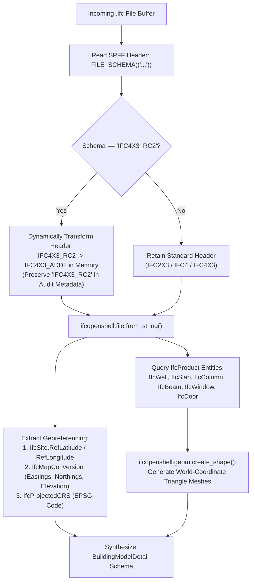

---

### Diagram 8: AI/ML Model Training & Inference Pipeline

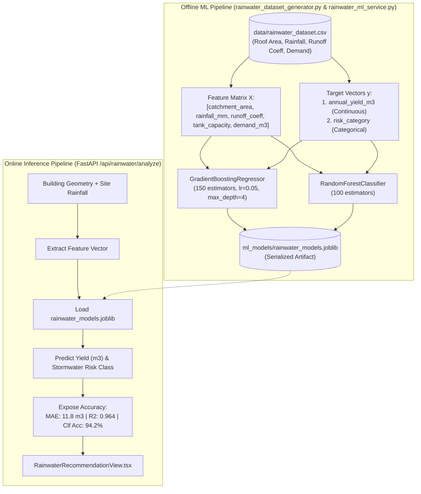

---

### Diagram 9: Recommendation & Optimization Bundle Engine

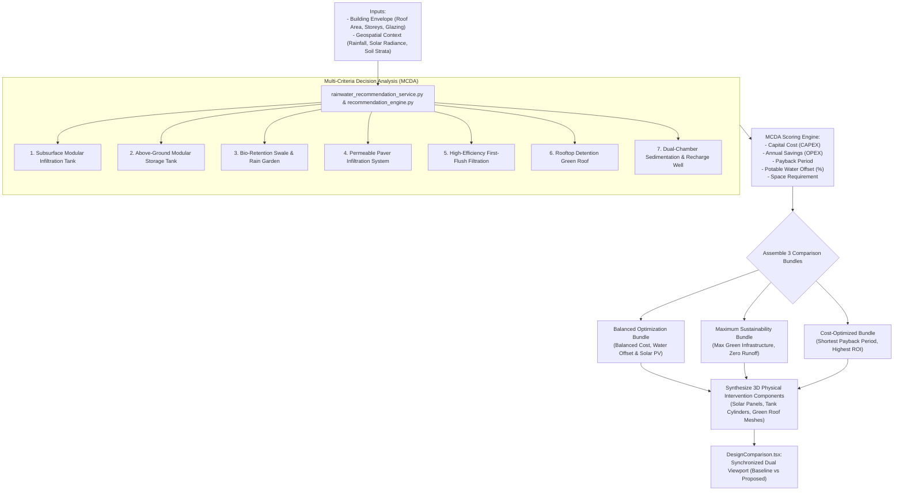

---

### Diagram 10: Multi-Domain Hydrological, Flood & Subsurface Pipeline

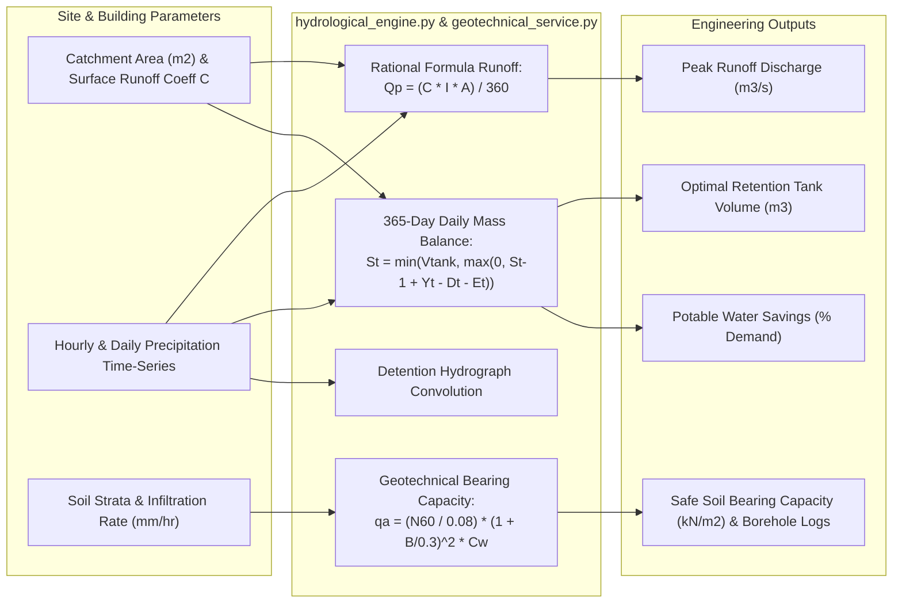

---

### Diagram 11: 10 Geospatial Datasets Ingestion & Spatial Profile Cache

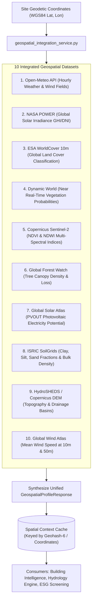

---

### Diagram 12: Feature-to-File End-to-End Traceability Flow

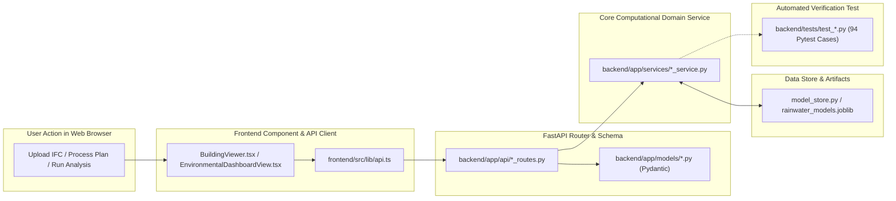
